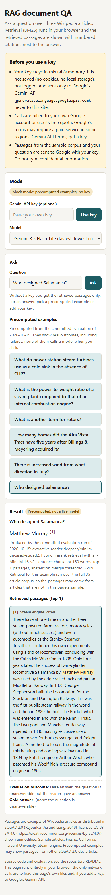
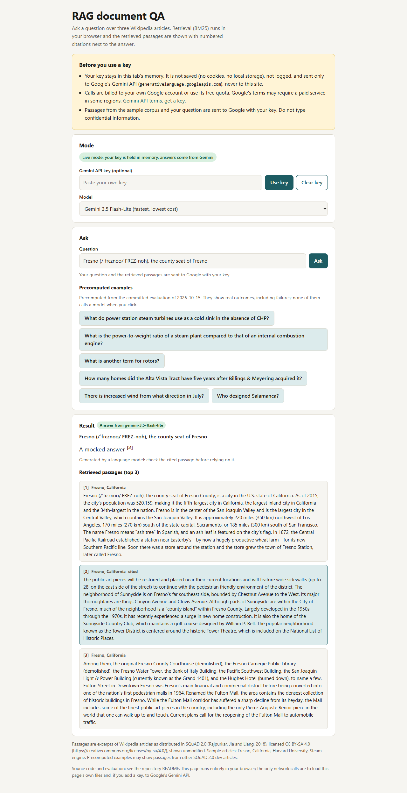
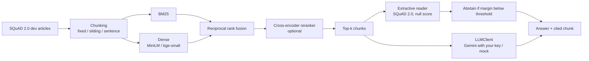

# RAG Document QA Eval: retrieval-augmented question answering with a measured evaluation

[](https://creativecommons.org/licenses/by-sa/4.0/)
[](https://github.com/Janeferdinant/rag-document-qa-eval/actions/workflows/ci.yml)

## Summary

<!-- BLOCK:summary:START -->
| Component | Configuration | Metric | Test result (mean [95% CI]) |
|---|---|---|---|
| Best retriever | hybrid+rerank, sentence chunks of 160 words, all-MiniLM-L6-v2 | Recall@5 | 0.973 [0.961, 0.983] |
| Best retriever | hybrid+rerank, sentence chunks of 160 words, all-MiniLM-L6-v2 | MRR@10 | 0.900 [0.883, 0.915] |
| Best retriever | hybrid+rerank, sentence chunks of 160 words, all-MiniLM-L6-v2 | nDCG@10 | 0.921 [0.907, 0.934] |
| BM25 baseline | same chunks | MRR@10 | 0.822 [0.799, 0.843] |
| Best reader pipeline | minilm-uncased-squad2 + hybrid+rerank, top-1, abstain below margin 3.209 | Exact match | 0.704 [0.672, 0.734] |
| Best reader pipeline | minilm-uncased-squad2 + hybrid+rerank, top-1, abstain below margin 3.209 | F1 | 0.732 [0.702, 0.761] |
| Best reader pipeline | minilm-uncased-squad2 + hybrid+rerank, top-1, abstain below margin 3.209 | Abstention precision | 0.771 [0.730, 0.812] |
| Best reader pipeline | minilm-uncased-squad2 + hybrid+rerank, top-1, abstain below margin 3.209 | Abstention recall | 0.797 [0.757, 0.835] |
| Best reader pipeline | minilm-uncased-squad2 + hybrid+rerank, top-1, abstain below margin 3.209 | Answer in retrieved context | 0.850 [0.813, 0.884] |
| Reader upper bound | gold paragraph given to the reader | F1 | 0.792 [0.763, 0.819] |
| Latency (CPU) | hybrid+rerank, top-1, one query at a time | End-to-end p50 / p95 | 493 / 611 ms |

Test split: 800 answerable questions for retrieval and 800 questions (answerable and unanswerable) for answering, from 25 Wikipedia articles that are disjoint from the 10 calibration articles used to choose settings. 95% percentile-bootstrap intervals over questions.
<!-- BLOCK:summary:END -->

All numbers on this page are rendered from the run logs in [`docs/runs/`](docs/runs) by `rag-qa report`. Full tables are in [`docs/results.md`](docs/results.md).

## Overview

A small retrieval-augmented question-answering system over Wikipedia articles, built to be evaluated rather than demonstrated: chunking strategies, BM25, dense retrieval, hybrid fusion and an optional cross-encoder reranker are compared with confidence intervals, and the answers come from an extractive SQuAD 2.0 reader that can abstain. The error analysis separates questions lost by retrieval from questions lost by reading. Everything runs on a CPU with local models; the only paid-API path (Gemini) needs your own key and is never used in the tests or in the committed evaluation.

## Demo

[`docs/index.html`](docs/index.html) is a static page (open it with `make serve`, then <http://localhost:8000/>). It holds a three-article sample corpus and runs BM25 retrieval in the browser. Paste your own Gemini key to get a generated answer with numbered citations next to the retrieved passages; the key stays in memory, is never stored or logged and is sent only to Google. Without a key the page shows precomputed examples from the committed evaluation, clearly labelled as precomputed (they include failures). Calls are billed to your own Google account and Google's terms may require a paid service in some regions. The page was checked with Playwright at 390 px and 1280 px with the Gemini request mocked (`make e2e`).

| 390 px, precomputed example | 1280 px, mocked live answer |
|---|---|
|  |  |

## Problem statement

Given a question and a document collection, return a short answer with a citation, or abstain when the collection does not contain the answer. The questions here are the SQuAD 2.0 development questions, about half of which are unanswerable by design. The evaluation asks which stage limits quality (retrieval or reading), which retrieval design works best, what abstention costs and what each stage costs in latency on a CPU.

## Approach



- **Chunking** (words, with character offsets so a chunk can be checked against the gold span): fixed-size, sliding window (50% overlap) and sentence-based, at 40, 80 and 160 words.
- **Retrieval**: Okapi BM25 (own implementation), dense retrieval with `all-MiniLM-L6-v2` and `bge-small-en-v1.5`, reciprocal rank fusion (k = 60) of BM25 and dense, and an optional `ms-marco-MiniLM-L-6-v2` cross-encoder over the top 20.
- **Reader**: `deepset/minilm-uncased-squad2` (default) and `deepset/tinyroberta-squad2`. Every retrieved chunk is read; the answer comes from the chunk with the largest margin between the best span score and the null score, and the system abstains when that margin is below a threshold tuned on calibration questions.
- **LLM path**: an `LLMClient` interface with a Gemini implementation (key in a header, never in a URL, redacted in errors) and a deterministic mock used by the tests.
- **Metrics**: Recall@k (a hit if a retrieved chunk fully contains a gold answer span), MRR@10, nDCG@10; exact match and F1 as in SQuAD 2.0; abstention precision and recall; answer-in-context rate; faithfulness checks; percentile-bootstrap 95% intervals over questions (2,000 resamples) and paired bootstrap differences.

### Evaluation protocol

1. The 35 SQuAD 2.0 dev articles form the corpus (1,204 paragraphs, about 152,000 words); each article is one document and chunks may cross paragraph boundaries.
2. Articles are split by a seeded shuffle into 10 **calibration** and 25 **test** articles. Questions from calibration articles choose settings (retriever, chunking, k, abstention threshold); only test-article questions are reported. No question or article is shared between the two sets.
3. Retrieval is scored on seeded samples of answerable questions; answering is scored on seeded samples with the natural answerable/unanswerable mix. Sample sizes are in the run logs.
4. The retrieval corpus is the whole 35-article collection for every question, not only the article the question was written about.
5. The reader models were trained on the SQuAD 2.0 training set according to their model cards, so the dev set is held out for them. The embedding and reranking models have their own training data; see Limitations.

## Data

SQuAD 2.0 dev set (Rajpurkar, Jia and Liang, 2018), CC BY-SA 4.0, downloaded at run time from the SQuAD site and verified against a pinned SHA-256 (`rag-qa ingest`). It is never committed. Licence evidence and attribution are in [`THIRD_PARTY_NOTICES.md`](THIRD_PARTY_NOTICES.md). The small demo files in `docs/data/` are verbatim excerpts under the same CC BY-SA 4.0 licence (see `docs/data/LICENSE-DATA.md`).

## Results

### Chunking and retriever ablation

<!-- BLOCK:ablation:START -->
| Chunking | Words | Chunks | Answer span cut | BM25 MRR@10 | Dense MRR@10 (all-MiniLM-L6-v2) | Hybrid MRR@10 |
|---|---|---|---|---|---|---|
| fixed | 40 | 3825 | 2.8% | 0.64 [0.62, 0.67] | 0.60 [0.57, 0.62] | 0.67 [0.64, 0.69] |
| fixed | 80 | 1921 | 1.1% | 0.75 [0.72, 0.77] | 0.66 [0.64, 0.69] | 0.75 [0.72, 0.77] |
| fixed | 160 | 970 | 0.9% | 0.80 [0.78, 0.83] | 0.65 [0.63, 0.68] | 0.77 [0.75, 0.79] |
| sliding | 40 | 7600 | 0.0% | 0.72 [0.70, 0.75] | 0.68 [0.65, 0.71] | 0.75 [0.73, 0.78] |
| sliding | 80 | 3790 | 0.0% | 0.79 [0.77, 0.82] | 0.72 [0.69, 0.74] | 0.80 [0.78, 0.82] |
| sliding | 160 | 1886 | 0.0% | 0.82 [0.80, 0.84] | 0.72 [0.69, 0.74] | 0.82 [0.79, 0.84] |
| sentence | 40 | 5056 | 0.2% | 0.72 [0.69, 0.74] | 0.69 [0.66, 0.72] | 0.75 [0.73, 0.78] |
| sentence | 80 | 2333 | 0.0% | 0.78 [0.76, 0.81] | 0.69 [0.66, 0.72] | 0.78 [0.76, 0.80] |
| sentence | 160 | 1067 | 0.0% | 0.82 [0.80, 0.84] | 0.69 [0.66, 0.72] | 0.80 [0.78, 0.82] |

Embedding models at sentence chunks of 160 words:

| Embedder | Dense MRR@10 | Hybrid MRR@10 | Dense Recall@5 | Hybrid Recall@5 |
|---|---|---|---|---|
| all-MiniLM-L6-v2 | 0.69 [0.66, 0.72] | 0.80 [0.78, 0.82] | 0.85 [0.82, 0.88] | 0.93 [0.91, 0.95] |
| bge-small-en-v1.5 | 0.72 [0.69, 0.74] | 0.81 [0.79, 0.83] | 0.88 [0.85, 0.90] | 0.93 [0.92, 0.95] |
<!-- BLOCK:ablation:END -->

### Top-k ablation (retrieval)

<!-- BLOCK:topk:START -->
sentence chunks of 160 words, test split. Recall@k is the share of questions with at least one retrieved chunk that fully contains a gold answer span in the top k.

| Retriever | Recall@1 | Recall@3 | Recall@5 | Recall@10 | Recall@20 |
|---|---|---|---|---|---|
| bm25 | 0.74 [0.71, 0.77] | 0.90 [0.87, 0.92] | 0.93 [0.91, 0.94] | 0.96 [0.94, 0.97] | 0.97 [0.96, 0.98] |
| dense | 0.57 [0.54, 0.61] | 0.77 [0.74, 0.80] | 0.85 [0.82, 0.88] | 0.92 [0.90, 0.94] | 0.95 [0.94, 0.97] |
| hybrid | 0.70 [0.67, 0.73] | 0.88 [0.86, 0.90] | 0.93 [0.91, 0.95] | 0.97 [0.95, 0.98] | 0.99 [0.98, 1.00] |
| hybrid+rerank | 0.84 [0.82, 0.87] | 0.95 [0.94, 0.97] | 0.97 [0.96, 0.98] | 0.99 [0.98, 0.99] | 0.99 [0.98, 1.00] |
<!-- BLOCK:topk:END -->

### Answering: reader, retriever and top-k

<!-- BLOCK:reader:START -->
Reader `deepset/minilm-uncased-squad2` (test split):

| Retriever | k | Threshold | EM | F1 | Abstention precision | Abstention recall | Answer in context |
|---|---|---|---|---|---|---|---|
| bm25 | 1 | 6.391 | 0.69 [0.66, 0.73] | 0.72 [0.69, 0.75] | 0.70 [0.66, 0.74] | 0.89 [0.86, 0.92] | 0.76 [0.72, 0.80] |
| bm25 | 3 | 6.391 | 0.71 [0.68, 0.74] | 0.74 [0.71, 0.77] | 0.76 [0.72, 0.80] | 0.84 [0.80, 0.88] | 0.89 [0.85, 0.92] |
| bm25 | 5 | 6.611 | 0.71 [0.68, 0.74] | 0.74 [0.71, 0.77] | 0.77 [0.73, 0.81] | 0.83 [0.79, 0.87] | 0.91 [0.88, 0.94] |
| dense | 1 | 3.178 | 0.63 [0.59, 0.66] | 0.64 [0.61, 0.68] | 0.66 [0.62, 0.70] | 0.84 [0.80, 0.87] | 0.61 [0.56, 0.66] |
| dense | 3 | 6.668 | 0.67 [0.64, 0.70] | 0.69 [0.66, 0.72] | 0.72 [0.68, 0.76] | 0.84 [0.80, 0.88] | 0.80 [0.76, 0.84] |
| dense | 5 | 8.925 | 0.68 [0.65, 0.72] | 0.70 [0.67, 0.73] | 0.69 [0.65, 0.73] | 0.89 [0.86, 0.92] | 0.87 [0.83, 0.90] |
| hybrid | 1 | 3.181 | 0.65 [0.62, 0.69] | 0.68 [0.65, 0.71] | 0.71 [0.66, 0.75] | 0.80 [0.76, 0.84] | 0.73 [0.69, 0.78] |
| hybrid | 3 | 6.668 | 0.71 [0.68, 0.74] | 0.74 [0.71, 0.77] | 0.76 [0.72, 0.80] | 0.85 [0.81, 0.88] | 0.89 [0.86, 0.92] |
| hybrid | 5 | 6.611 | 0.72 [0.69, 0.75] | 0.74 [0.71, 0.77] | 0.79 [0.75, 0.83] | 0.83 [0.80, 0.87] | 0.94 [0.91, 0.96] |
| hybrid+rerank (selected) | 1 | 3.209 | 0.70 [0.67, 0.73] | 0.73 [0.70, 0.76] | 0.77 [0.73, 0.81] | 0.80 [0.76, 0.84] | 0.85 [0.81, 0.88] |
| hybrid+rerank | 3 | 5.435 | 0.70 [0.67, 0.74] | 0.73 [0.70, 0.76] | 0.80 [0.76, 0.84] | 0.77 [0.73, 0.81] | 0.96 [0.94, 0.98] |
| hybrid+rerank | 5 | 5.435 | 0.70 [0.67, 0.73] | 0.73 [0.70, 0.76] | 0.82 [0.78, 0.86] | 0.75 [0.71, 0.79] | 0.97 [0.95, 0.98] |
| oracle paragraph | - | 1.323 | 0.76 [0.73, 0.79] | 0.79 [0.76, 0.82] | 0.87 [0.84, 0.91] | 0.75 [0.71, 0.79] | - |

Readers at the selected retriever (hybrid+rerank, top-1):

| Reader | Threshold | EM | F1 | Abstention precision | Abstention recall | F1 with gold paragraph |
|---|---|---|---|---|---|---|
| deepset/minilm-uncased-squad2 | 3.209 | 0.70 [0.67, 0.73] | 0.73 [0.70, 0.76] | 0.77 [0.73, 0.81] | 0.80 [0.76, 0.84] | 0.79 [0.76, 0.82] |
| deepset/tinyroberta-squad2 | 4.462 | 0.70 [0.67, 0.73] | 0.73 [0.70, 0.76] | 0.75 [0.71, 0.79] | 0.83 [0.79, 0.87] | 0.80 [0.77, 0.82] |

Citation checks (selected pipeline): the cited chunk contains the answer text in 0.992 [0.983, 1.000] of answers (true by construction for an extractive reader), and for answers with F1 >= 0.5 the cited chunk contains a gold answer span in 0.964 [0.940, 0.983].
<!-- BLOCK:reader:END -->

### Error analysis: retrieval failures versus reading failures

<!-- BLOCK:errors:START -->
| category | count | meaning |
|---|---|---|
| correct | 249 | answerable question, exact match with a gold answer |
| retrieval_failure | 60 | answerable, but no retrieved chunk contains a gold answer string |
| reading_failure_abstained | 52 | answerable, answer in the retrieved chunks, reader abstained |
| reading_failure_wrong_span | 19 | answerable, answer in the retrieved chunks, reader gave a different span (F1 < 0.5) |
| boundary_mismatch | 26 | answerable, reader's span overlaps the gold answer (0 < F1 < 1, not EM) |
| correct_abstention | 314 | unanswerable question, reader abstained |
| false_answer | 80 | unanswerable question, reader gave an answer |

Out of 406 answerable test questions, 60 fail because the answer is not in the retrieved chunks (retrieval failures) and 97 fail although it is (reading failures); 77 of those reading failures also fail when the reader is given the gold paragraph.

Examples (SQuAD 2.0 questions, ids hashed; text from Wikipedia via SQuAD, CC BY-SA 4.0):

- `40e7d9c6` retrieval_failure: "What is missing a theory on quantum gravity?" gold: 'General relativity'; predicted: None; reader correct with the gold paragraph: True.
- `83f6925b` reading_failure_abstained: "What components raise steam temperature above its saturated vapor point?" gold: 'superheaters'; predicted: None; reader correct with the gold paragraph: False.
- `40b1cc08` reading_failure_wrong_span: "X.25 uses what type network type " gold: 'User Datagram Protocol'; predicted: 'The X.25 protocol suite uses this network type'; reader correct with the gold paragraph: False.
- `a15b883a` boundary_mismatch: "How quickly can an algorithm solve an NP-complete knapsack problem?" gold: 'in less than quadratic time'; predicted: 'over a wide range of sizes in less than quadratic time'; reader correct with the gold paragraph: False.
- `2f0be477` false_answer: "What is an example of complicated exhaust, along with Stephenson and Walschaerts?" gold: '(unanswerable)'; predicted: 'Joy'; reader correct with the gold paragraph: True.
<!-- BLOCK:errors:END -->

### Latency on CPU

<!-- BLOCK:latency:START -->
100 questions, top-1 chunks read, 1067 chunks indexed, batch size 1, warm models. CPU: AMD64 Family 25 Model 33 Stepping 0, AuthenticAMD (16 logical cores, 8 torch threads), no GPU. Values are milliseconds, p50 / p95.

| Retriever | Retrieval | Reader | End to end |
|---|---|---|---|
| bm25 | 0.2 / 0.2 | 58.9 / 74.3 | 59.0 / 74.5 |
| dense | 14.5 / 21.1 | 59.6 / 74.6 | 74.2 / 91.1 |
| hybrid | 15.0 / 19.6 | 59.6 / 75.9 | 75.7 / 94.6 |
| hybrid+rerank | 430.6 / 538.9 | 60.2 / 80.1 | 493.5 / 610.7 |
<!-- BLOCK:latency:END -->

### Reading the results

Numbers below are quoted from the tables above and from `docs/runs/2026-10-15-*.json`.

- **BM25 is a strong first stage on SQuAD, and hybrid fusion did not beat it here.** At sentence chunks of 160 words, BM25 reaches MRR@10 0.82 and the dense retrievers 0.69 (MiniLM) and 0.72 (bge-small). The paired difference dense minus BM25 is -0.131 [-0.161, -0.102] MRR@10. Hybrid minus BM25 is -0.020 [-0.041, +0.000] MRR@10 and +0.006 [-0.013, +0.026] Recall@5, so fusion gave no measurable gain on these questions. A possible reason, not tested here, is that SQuAD questions were written by people looking at the paragraph and so share many words with the answer sentence.
- **The cross-encoder reranker is the one retrieval change with a clear effect.** Reranking the top 20 of the hybrid ranking adds +0.098 [+0.079, +0.119] MRR@10 over hybrid and +0.078 [+0.058, +0.100] over BM25, and Recall@5 rises to 0.973. It costs about 430 ms per query on this CPU, far more than any other retrieval stage. It was evaluated only at the best first-stage chunking (the reranker is slow on a CPU), and with the MiniLM hybrid ranking.
- **Chunking matters, and larger was better up to the largest size tested.** BM25 and hybrid MRR@10 rise with chunk size for every strategy (160 words was the largest size tried); dense MRR@10 does not increase from 80 to 160 words. Fixed-size chunking cuts the gold answer span in 0.9% to 2.8% of questions, while sliding-window and sentence chunking cut it in 0.2% or fewer. Sentence and sliding chunks of the same size are within each other's intervals for BM25.
- **Better retrieval helped end-to-end answering much less than it helped retrieval.** With three chunks read, BM25 gives F1 0.74 [0.71, 0.77] and hybrid+rerank 0.73 [0.70, 0.76]; these intervals overlap almost entirely, so the committed runs show no end-to-end difference among BM25, hybrid and hybrid+rerank at k = 3 or 5. The reranker's benefit shows when only one chunk is read (F1 0.73 for hybrid+rerank, against 0.64 for dense and 0.68 for hybrid; BM25 at k = 1 is 0.72 [0.69, 0.75], again overlapping). The selected pipeline (top-1 with the reranker) was chosen on the calibration questions; the comparisons above are between unpaired intervals.
- **Reading is the bigger limit than retrieval.** Of 406 answerable test questions, 60 are lost because the answer is not in the retrieved chunk and 97 are lost although it is. 77 of those 97 also fail when the reader is given the gold paragraph, so they are limits of the reader (or of strict exact-match scoring), not of the retrieved context. Giving the reader the gold paragraph raises F1 from 0.73 to 0.79. For reference, the reader's model card reports F1 79.5 on the full SQuAD 2.0 dev set.
- **Abstention is imperfect.** Of 394 unanswerable test questions the pipeline abstained on 314 and gave an answer to 80. SQuAD 2.0's unanswerable questions are written to look like answerable ones, which is why a global score threshold (here a margin of 3.2, tuned on 300 calibration questions) cannot separate them cleanly.
- **The two readers are indistinguishable at this sample size.** `minilm-uncased-squad2` and `tinyroberta-squad2` both reach F1 0.73 end-to-end, and 0.79 and 0.80 with the gold paragraph. The smaller MiniLM reader is the default because it is faster: the reader run log records 39.2 ms per passage for MiniLM and 61.5 ms for tinyroberta (batched, on a shared machine, so indicative).
- **Latency.** BM25 retrieval takes 0.2 ms, dense and hybrid retrieval about 15 ms, the reranker about 430 ms, and the reader about 60 ms for one chunk; end to end the pipelines take 59 ms (BM25) to 494 ms (hybrid+rerank) at p50 on a 16-thread CPU.

## Tech stack

Python 3.10, PyTorch (CPU), Hugging Face `transformers` and `sentence-transformers`, NumPy; pytest, ruff, mypy; Playwright for the page checks; plain HTML, CSS and ES modules for the demo (no build step).

## Getting started

Prerequisites: Python 3.10 or newer, about 2 GB of disk for the models and caches, no GPU needed.

```bash
git clone https://github.com/Janeferdinant/rag-document-qa-eval.git
cd rag-document-qa-eval
python -m venv .venv
. .venv/bin/activate            # Windows: .venv\Scripts\activate
make install-dev
make test lint typecheck        # fast checks, no downloads
make data                       # downloads SQuAD 2.0 dev (4.4 MB) and checks its SHA-256
make smoke                      # tiny end-to-end run of all stages (a few minutes, writes to .tmp/smoke-runs)
```

Reproduce the committed numbers (each stage is a separate run of under 25 minutes on a 16-thread CPU):

```bash
make evaluate                   # retrieval, reader and latency stages; writes docs/runs/<date>-*.json and *.md
make report                     # re-renders the tables in this README and docs/results.md from the run logs
```

Ask a question from the command line:

```bash
rag-qa ask "Where does the Rhine begin?"                      # extractive reader, no key, no cost
rag-qa ask "your question" --docs notes1.txt notes2.txt       # over your own text files
GEMINI_API_KEY=... rag-qa ask "your question" --llm gemini    # optional, billed to your own Google account
```

Browser checks (they mock the Gemini request; no real call is made):

```bash
pip install playwright==1.64.0 && playwright install chromium
make e2e
```

`make demo-data` regenerates `docs/data/` from the latest reader run.

## Project structure

```
src/rag_qa_eval/   chunking, bm25, fusion, retrieval, models, reader (abstention), llm, qa_metrics, metrics,
                   analysis, eval_retrieval / eval_reader / eval_latency, report, demo_export, cli
tests/             pytest (fast, no downloads); tests/e2e has the Playwright checks
docs/              index.html, rag.js, app.js, style.css, data/ (demo), runs/ (run logs), results.md, screenshots/
```

## Limitations

- **Wikipedia-style English questions only.** SQuAD questions are written by crowd workers who saw the paragraph. Many reuse the paragraph's wording, which favours lexical retrieval (BM25), and some are ambiguous without their paragraph, which inflates retrieval failures. Nothing here shows how the results carry over to other languages, domains, long documents, tables or conversational questions.
- **A small subset.** The corpus is the 35 SQuAD 2.0 dev articles (1,204 paragraphs, about 152,000 words), so the retrieval task is easier than a large collection would be. Retrieval is scored on 800 and answering on 800 seeded test questions from 25 articles, and settings were chosen on 300 questions from 10 other articles. Intervals reflect question sampling only: a single article split and question sample (seed 13) was used, so the sensitivity of the conclusions to other splits was not measured. The abstention threshold is tuned on only 300 calibration questions.
- **Training-data overlap.** The default embedder `all-MiniLM-L6-v2` lists SQuAD 2.0 (87,599 pairs) among its training data. That count is close to the size of the SQuAD training split, so the dev set is probably not included, but the card does not say, and the model has at least seen SQuAD-style questions. The `bge-small` card was not checked for this. The reranker was trained on MS MARCO. Both could advantage the neural retrievers on SQuAD; BM25 still scored higher.
- **Extractive reader limits.** It can only copy a span of at most 30 tokens from one chunk, so it cannot combine facts from several passages, rephrase or answer yes/no questions. Exact match penalises valid alternative spans, one reason for the "boundary mismatch" category. The abstention threshold is one global margin, not calibrated per question.
- **Faithfulness is only checked lexically.** The check asks whether the answer text occurs in the cited chunk (0.992 for the extractive reader, which is close to 1 by construction) and, for good answers, whether the cited chunk contains a gold span. It is not an entailment test. No LLM answers are part of the committed evaluation, so there is no measured faithfulness figure for generated answers.
- **The Gemini path is only tested against mocks.** The Python client and the browser demo were exercised with a mocked transport and a mocked request, never against the real API, so model availability, CORS behaviour, quotas and billing messages in real use are untested here. Model ids were read from Google's model list on 2026-10-15 and may change.
- **Grid limits.** Chunk sizes stop at 160 words because the embedders truncate at 256 word pieces; the best sizes were at that edge. The reranker was evaluated at one chunking, and BM25 uses a plain tokenizer without stemming.
- **Timing.** Latencies were measured once, on 100 questions, on a shared 16-thread desktop CPU, with one query at a time. They are indicative, not a benchmark. The retrieval and reader stages took 23 and 25 minutes of wall time (1,386 s and 1,479 s) on that machine.
- **The browser demo** retrieves with BM25 only, over three articles, and its precomputed examples come from the full 35-article corpus.

## Future scope

- Re-run with a larger and a more varied corpus (more articles, other domains, other languages) to see which conclusions survive.
- Try a stronger reader or an LLM reader inside the evaluation and report the cost per answer; the `LLMClient` interface and the faithfulness check are in place for it.
- Replace the lexical faithfulness check with an entailment model and a small human-labelled sample.
- Fine-tune the embedder and the reranker on the training questions and compare with the zero-shot models.
- Tune the abstention rule jointly with retrieval (for example a margin that also uses the retrieval score).
- Measure throughput under concurrent load and with quantised models.

## Credits & citation

Data and models are credited in [`THIRD_PARTY_NOTICES.md`](THIRD_PARTY_NOTICES.md): SQuAD 2.0 (Rajpurkar, Jia and Liang, ACL 2018), sentence-transformers `all-MiniLM-L6-v2`, BAAI `bge-small-en-v1.5`, the MS MARCO cross-encoder, and deepset's SQuAD 2.0 readers. Passages and questions quoted in this repository come from Wikipedia as distributed in SQuAD 2.0 (CC BY-SA 4.0).

## License

Original work © Jane Rose Ferdinant, licensed CC BY-SA 4.0. Third-party components retain their own licenses; see [THIRD_PARTY_NOTICES.md](THIRD_PARTY_NOTICES.md).

## Author

Jane Rose Ferdinant: [Portfolio](https://janeferdinant.vercel.app) · [LinkedIn](https://www.linkedin.com/in/janerosenf/)
